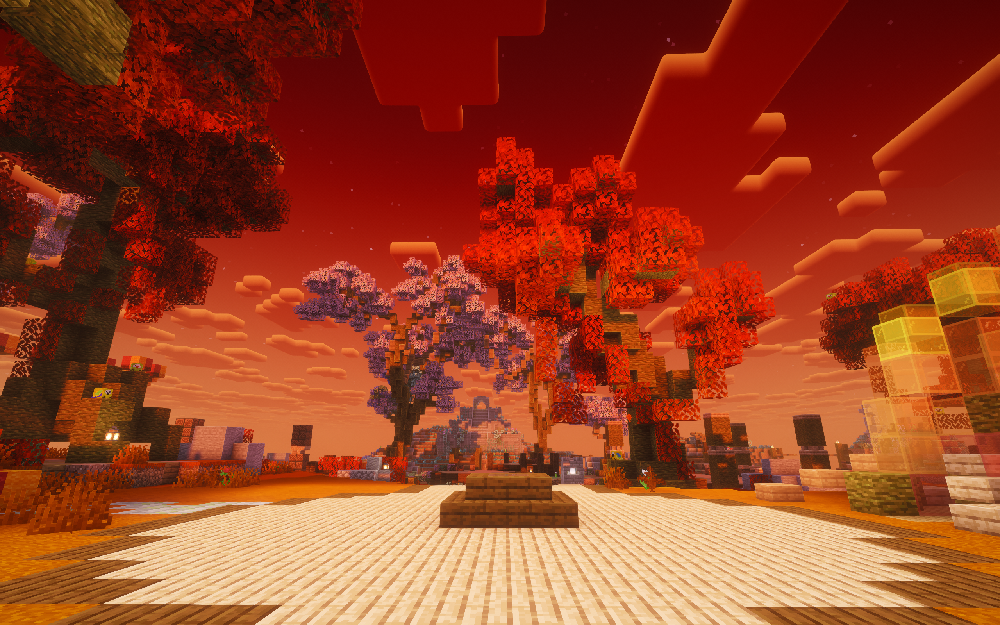

# EnthusiaBiomes


*Screenshot from the hub on `play.enthusia.info`*

A powerful Paper plugin for creating **unlimited custom biomes** with unique colors through simple YAML configuration. No coding required!

## Features

- **YAML Configuration** - Define biomes with just hex colors and a name
- **Complete Color Control** - Customize fog, water, water fog, sky, grass, and foliage colors
- **Environment Attributes** - Full support for 1.21.11's new environment attribute system (fog, sky, water fog)
- **Biome Cycling** - Automatically rotate biomes on a timer for hub worlds
- **Pre-built Themes** - Vice City Sunset, Neon Cyberpunk, Ocean Paradise, Cherry Blossom, and more
- **Easy Commands** - Simple commands to apply biomes to chunks with configurable radius
- **WorldEdit Compatible** - All biomes are registered to the server's biome registry, making them fully available with WorldEdit/FAWE tools like `//setbiome`, `//brush biome`, and more

## Requirements

- Paper 1.21.11+
- Java 21+

## Installation

1. Download `EnthusiaBiomes-1.0.0-reobf.jar` from releases
2. Place it in your server's `plugins/` folder
3. Restart your server
4. Edit `plugins/EnthusiaBiomes/config.yml` to customize biomes
5. Run `/reloadbiomes` to apply changes

## Commands

| Command | Description | Permission |
|---------|-------------|------------|
| `/setbiome <id> [radius]` | Apply a custom biome to chunks | `custombiomes.setbiome` |
| `/listbiomes` | List all available custom biomes | `custombiomes.list` |
| `/reloadbiomes` | Reload config and re-register biomes | `custombiomes.reload` |
| `/checkbiomes` | Debug: verify biomes in Bukkit registry | `custombiomes.check` |
| `/biomecycle [start\|stop\|skip\|status]` | Control automatic biome cycling | `custombiomes.cycle` |

## Permissions

| Permission | Description | Default |
|------------|-------------|---------|
| `custombiomes.*` | All permissions | op |
| `custombiomes.setbiome` | Use /setbiome | op |
| `custombiomes.list` | Use /listbiomes | everyone |
| `custombiomes.reload` | Use /reloadbiomes | op |
| `custombiomes.check` | Use /checkbiomes | op |
| `custombiomes.cycle` | Use /biomecycle | op |

## Configuration

### Defining Biomes

Each biome in `config.yml` follows this format:

```yaml
biomes:
  your_biome_name:
    name: "Display Name"
    fog_color: "FF6B35"        # Hex color for fog
    water_color: "1B9AAA"      # Hex color for water
    water_fog_color: "2A6F97"  # Hex color for underwater fog
    sky_color: "E85D75"        # Hex color for sky
    foliage_color: "2D6A4F"    # Hex color for leaves/plants
    grass_color: "52B788"      # Hex color for grass blocks
    temperature: 0.9           # -2.0 to 2.0 (below 0.15 = snow)
    rainfall: 0.7              # 0.0 to 1.0
```

Leave any color empty (`""`) to use Minecraft's defaults.

### Namespace

Customize the biome namespace that appears in-game:

```yaml
settings:
  namespace: "enthusia"  # Biomes appear as "enthusia:vice_city_sunset"
```

### Biome Cycling

Automatically rotate the world biome on a timer - great for hub worlds:

```yaml
biome_cycling:
  enabled: true
  world: "world"
  interval_minutes: 10
  biome_cycle:
    - vice_city_sunset
    - cherry_blossom
    - neon_cyberpunk
  announce_changes: true
  change_message: "&7The world atmosphere shifts to &e{biome}&7..."
```

## Pre-configured Biomes

| Biome | Vibe |
|-------|------|
| `vice_city_sunset` | Miami sunset with orange fog and teal water |
| `neon_cyberpunk` | Hot pink fog, cyan water, purple sky |
| `ocean_paradise` | Crystal clear tropical waters |
| `mystic_forest` | Deep purple and blue magical atmosphere |
| `desert_oasis` | Warm golden desert with bright oasis water |
| `cherry_blossom` | Soft pink Japanese aesthetic |
| `volcanic_wasteland` | Crimson skies and blood-red water |
| `arctic_aurora` | Icy teal aurora-colored sky |

## Building from Source

```bash
./gradlew build
```

The server-ready JAR is output to `build/libs/EnthusiaBiomes-1.0.0-reobf.jar`.

## Support

- Server: `play.enthusia.info`

---

Copyright (c) 2025 Enthusia Network
